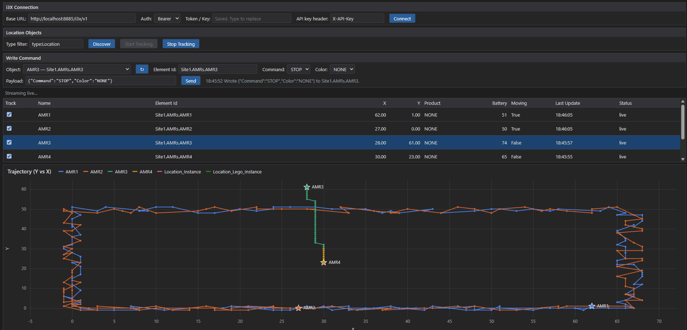

# i3X Location Tracker

A browser app (ASP.NET Core, .NET 8, Windows) that connects to an [i3X](https://github.com/cesmii/i3X) server, discovers every object whose type is `Location`, and plots their live X/Y trajectory in real time. There's no polling: it's driven entirely by the i3X push-subscription (SSE) API. It can also send commands to any object.

Built for tracking things like AMRs (autonomous mobile robots) that report `{ Timestamp, X, Y, Z, Battery, IsMoving, Product }` readings.

Built with Claude Code; the [i3x-mcp](https://www.npmjs.com/package/i3x-mcp) MCP server was used during development for Claude to explore the live i3X server's object catalog and capabilities.

See [Chat-Transcript.pdf](Chat-Transcript.pdf) for the full conversation this app was designed and built in. It started as a Windows desktop (WPF) app, which was later replaced by this browser version.



---

## Run it

```bash
dotnet run --project I3XLocationTracker.Web
```

Then open <http://localhost:5085>, or `http://<this-computer's-IP>:5085` from another computer. Windows Firewall must allow inbound TCP port 5085.

> **This is a test program.** It is open to the whole network over plain HTTP with no login. Anyone who can reach port 5085 can change the connection settings and use **Write Command to move physical robots**, so only run it on a network you trust.

### Run as a Windows service

To keep the app running without a logged-in user, run this from an **administrator** PowerShell in the repo folder. Run it again to update the service after code changes.

```powershell
powershell -ExecutionPolicy Bypass -File .\I3XLocationTracker.Web\install-service.ps1
```

It builds the app, installs it to `C:\Program Files\I3X Location Tracker Web`, and registers the `I3XLocationTrackerWeb` service to start with Windows and restart on failure.

The service runs as the low-privilege LocalService account, so it keeps its own settings and token, separate from yours. The first time, open the page, set Auth to Bearer, enter the token and click **Connect**. Port 5085 must be free, so stop any copy started with `dotnet run` first.

To remove it, run `uninstall-service.ps1` the same way.

## Using the app

1. **i3X Connection**: enter the i3X base URL, pick an auth scheme, and (if needed) the token/key. Click **Connect**.
2. **Location Objects**: adjust the type filter if needed (default `type:Location`), then click **Discover**.
3. Click **Start Tracking** to open the subscription and begin streaming. The table and trajectory chart update live.
4. Uncheck an object's **Track** box to hide its line on the chart without stopping its data.
5. Click **Stop Tracking** to end the subscription cleanly.
6. To command an object, pick it in the **Write Command** panel (or click its row), choose Command and Color, and click **Send**.

Settings are remembered automatically, so there's nothing to save manually.

---

## Features

### Connection
- Connects to any i3X server over its versioned REST API (default `http://localhost:8885/i3x/v1`).
- Auth schemes: **None**, **Bearer** token, or **API key** (with a configurable header name, default `X-API-Key`).
- `Connect` validates the server via `GET /info` and reports its name and spec version.

### Discovery
- `Discover` calls `GET /objects` filtered by a configurable **type filter** (default `type:Location`) to find every matching object.
- Falls back to an unfiltered `GET /objects` + filtering in the app if the server doesn't support the query-param filter.
- Each discovered object gets its own color, used consistently in the chart line, its marker and the legend.

### Live tracking: streaming, not polling
`Start Tracking` opens a real i3X **subscription** and streams updates as they happen:
1. `POST /subscriptions` opens a subscription under a generated client ID.
2. `POST /subscriptions/register` registers every discovered element against it.
3. `POST /subscriptions/stream` opens the i3X Server-Sent-Events stream. The server reads it continuously and passes each update on to the page, also as Server-Sent Events. Nothing re-fetches values on a timer.
4. If the stream drops or the i3X server closes it, the app reconnects after a 3-second delay.
5. `Stop Tracking`, or closing the page, ends the stream and calls `POST /subscriptions/delete` to clean up on the i3X server.

### Trajectory chart
- A single X/Y plot, **X on the horizontal axis, Y on the vertical axis**, showing each tracked object's path as a line with small dots along the trail. It keeps a 10-minute rolling window and trims older points automatically.
- A **star marker** shows each object's current position, labelled with its name when four or fewer objects are shown.
- Hover over the chart to see the nearest point's object, X, Y and time.
- The **Track** checkboxes in the table show or hide an object's line without dropping its subscription.
- Axes autoscale to the live data range. The chart is drawn on a canvas with no outside libraries, using a color palette checked for colorblind separation and contrast on the dark background.

### Live data table
Shows, per discovered object: name, element ID, latest X/Y, product, battery, moving flag, last-update time, and a status column (`live`, `waiting for data…`, `no X/Y data`) for at-a-glance health.

### Write commands
The **Write Command** panel sends a JSON payload to any object, addressed by its Element Id, with `PUT /objects/value`:
- **Object** lists every object on the server (any type, loaded on Connect; ↻ reloads it). Clicking a row in the table, or typing an **Element Id** directly, also sets the target.
- **Command** (`GO` / `STOP`) and **Color** (`NONE` / `BLUE` / `RED`) generate the payload, e.g. `{"Command":"GO","Color":"BLUE"}`. The **Payload** box is editable, so any valid JSON can be sent.
- **Send** writes the payload as the object's new current value (quality `Good`, current timestamp) and shows success or the server's error under the panel.
- The target Element Id, command and color are remembered with the other settings.

### Settings and token
Every connection field (Base URL, auth scheme, API key header, type filter, and the token/key itself) and the Write Command choices are saved automatically to:
```
%AppData%\I3XLocationTracker\settings.json
```
- Saves are **debounced** (400ms) so a burst of keystrokes becomes one save, and are written atomically (write-to-temp then replace) so a crash mid-save can't corrupt the file.
- **The token/key is never written in plain text.** It's encrypted with Windows DPAPI for the Windows account the server runs under, so only that account on that machine can read it.
- **The token stays on the server.** The page can replace it, but can never read it back.

---

## Requirements

- Windows with the .NET 8 SDK (or the ASP.NET Core 8 Runtime to run a published build). Windows is required because the token is encrypted with Windows DPAPI.
- An i3X server reachable over HTTP(S) (tested against a local HighByte Intelligence Hub instance at `http://localhost:8885/i3x/v1`).

## Demo i3X server config

[`intelligencehub-deployment_i3XLocationTracker.json`](https://github.com/glenwirth/HighBytePublic/blob/main/intelligencehub-deployment_i3XLocationTracker.json) is an exported **HighByte Intelligence Hub 4.5** project configuration, hosted in the [HighBytePublic](https://github.com/glenwirth/HighBytePublic) repo. Importing it into a HighByte Intelligence Hub instance stands up an i3X server that simulates live AMR `Locations` data (plus a production-line demo), a quick way to have something for this app to connect to and track without a real AMR fleet.

> **Note:** this file contains a plaintext database credential and an internal server IP for the demo environment it was exported from. Treat it as sensitive if you didn't intend for it to be public.

## Lego Spike Prime AMR code

[`LegoSpikePrimeAMRIntegrationUsingMQTT/`](LegoSpikePrimeAMRIntegrationUsingMQTT/) contains the code for physical Lego AMRs that this app can track and command:

- **`Pybricks/`**: the **Lego Spike Prime [Pybricks](https://pybricks.com/) Python code** for the hub (`amr3_pybricks.py`, `amr4_pybricks.py`). It drives the motors and sensors and talks to the Wi-Fi backpack over UART on port A.
- **`WifiCard/`**: the **ESP8266 Wi-Fi Backpack MicroPython code** (`boot.py`, `main.py`). It joins Wi-Fi, then bridges the hub to an MQTT broker. It publishes position and status, and subscribes to `Site1/AMRs/AMR1/Command`. Wi-Fi and broker settings are in `wifi_data.py` and `mqtt_data.py`.
  To load this code onto the ESP8266 over USB you need two Windows tools. They aren't included in the repo, so download them:
  - **CH341 USB-to-serial driver** (`CH341SER.ZIP`), from SparkFun's [How to Install CH340 Drivers](https://learn.sparkfun.com/tutorials/how-to-install-ch340-drivers/windows-710) guide. It's the Windows driver for the backpack's CH341 chip. Unzip it and run `CH341SER\SETUP.EXE`, and the ESP8266 shows up as a COM port.
  - **Thonny** (`thonny-5.0.1-windows-portable-x64.zip`), from [thonny.org](https://thonny.org/). It's a Python IDE used to set up, configure and edit MicroPython on the ESP8266. The portable version needs no install: unzip it and run `thonny.exe`. In Thonny, choose **MicroPython (ESP8266)** and the backpack's COM port as the interpreter, then open, edit and save `boot.py`, `main.py`, `wifi_data.py` and `mqtt_data.py` on the device.
- **`MQTTMessages.txt`**: sample MQTT topics and payloads, including the `{"Command":"GO","Color":"BLUE"}` style command messages that the **Write Command** panel sends.

> **Note:** `WifiCard/wifi_data.py` contains a plaintext Wi-Fi network name and password, and `mqtt_data.py` an internal broker IP. Change them to match your own network before flashing the backpack.

---

## Project structure

```
I3XLocationTracker/
├── I3XLocationTracker.Web/
│   ├── Program.cs               Web server: settings, i3X calls, live stream to the page
│   ├── Services/
│   │   ├── I3xClient.cs         HTTP client for the i3X REST API (info, objects, writes, subscriptions, SSE stream)
│   │   └── SettingsService.cs   Loads/saves settings.json; DPAPI-encrypts the token
│   ├── Models/
│   │   ├── I3xModels.cs         i3X request/response shapes + Location reading parsing
│   │   └── AppSettings.cs       Saved settings shape
│   ├── wwwroot/                 Page, styles, and the UI and trajectory chart script (app.js)
│   └── install-service.ps1 / uninstall-service.ps1   Add or remove the Windows service
└── LegoSpikePrimeAMRIntegrationUsingMQTT/   Lego AMR hub and Wi-Fi backpack code
```

### i3X REST endpoints used

| Endpoint | Purpose |
|---|---|
| `GET /info` | Validate the connection; server name/version/capabilities |
| `GET /objects?typeElementId=...` | Discover objects by type, and list all objects for Write Command |
| `POST /subscriptions` | Open a subscription |
| `POST /subscriptions/register` | Register elements to watch |
| `POST /subscriptions/stream` | Open the SSE push stream |
| `POST /subscriptions/delete` | Tear down a subscription |
| `PUT /objects/value` | Write a command payload to an object |

### Expected object shape

Objects of type `Location` are expected to expose a current value shaped like:
```json
{
  "Timestamp": 1794143297862,
  "X": 66,
  "Y": 13,
  "Z": 0,
  "Battery": 94,
  "IsMoving": true,
  "Product": "NONE"
}
```
`Timestamp` may be epoch milliseconds or an ISO-8601 string; both are handled.

---

## Notes & limitations

- HighByte i3X tokens begin with `i3X.`, which is part of the token. Without it the server answers `401 Unauthorized`.
- The Windows service keeps its settings and token under `C:\Windows\ServiceProfiles\LocalService\AppData\Roaming\I3XLocationTracker`.
- The encrypted token is tied to one Windows account and machine, so copying `settings.json` elsewhere won't bring a usable token with it.
- The 10-minute rolling window and the 8-color palette are set at the top of `wwwroot/app.js`. Objects beyond the eighth are drawn in gray.
- If the i3X server enforces auth on some endpoints but not others (as some demo servers do), `Connect` may succeed while `Discover` or `Start Tracking` fails with 401. Check the auth scheme and token if that happens.
