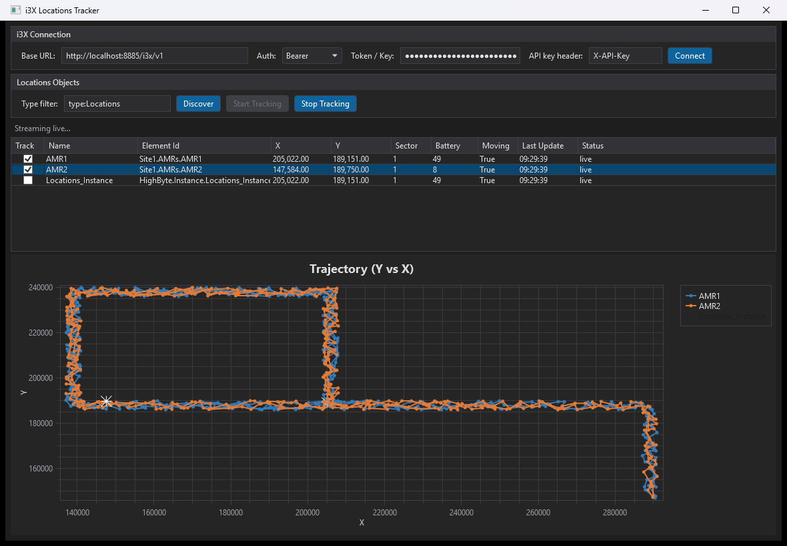

# i3X Locations Tracker

A Windows desktop app (WPF, .NET 8), with a [browser version](#web-app), that connects to an [i3X](https://github.com/cesmii/i3X) server, discovers every object whose type is `Locations`, and plots their live X/Y trajectory in real time — no polling, driven entirely by the i3X push-subscription (SSE) API.

Built for tracking things like AMRs (autonomous mobile robots) that report `{ Timestamp, X, Y, Z, Battery, IsMoving, Product }` readings.

Built with Claude Code; the [i3x-mcp](https://www.npmjs.com/package/i3x-mcp) MCP server was used during development for Claude to explore the live i3X server's object catalog and capabilities.

See [Chat-Transcript.pdf](Chat-Transcript.pdf) for the full conversation this app was designed and built in.



---

## Features

### Connection
- Connects to any i3X server over its versioned REST API (default `http://localhost:8885/i3x/v1`).
- Auth schemes: **None**, **Bearer** token, or **API key** (with a configurable header name, default `X-API-Key`).
- `Connect` validates the server via `GET /info` and reports its name and spec version.

### Discovery
- `Discover` calls `GET /objects` filtered by a configurable **type filter** (default `type:Locations`) to find every matching object.
- Falls back to an unfiltered `GET /objects` + client-side filtering if the server doesn't support the query-param filter.
- Each discovered object gets a distinct color, used consistently across the data grid, trajectory line, and legend.

### Live tracking — SSE streaming, not polling
`Start Tracking` opens a real i3X **subscription** and streams updates as they happen:
1. `POST /subscriptions` — opens a subscription under a generated client ID.
2. `POST /subscriptions/register` — registers every discovered element against it.
3. `POST /subscriptions/stream` — opens the Server-Sent-Events stream and reads it continuously on a background task, parsing `data: [...]` frames as they arrive (SSE comment/heartbeat lines are ignored). Nothing re-fetches values on a timer.
4. If the stream drops or the server closes it, the app automatically reconnects after a 3-second delay.
5. `Stop Tracking` cancels the read loop and best-effort calls `POST /subscriptions/delete` to clean up server-side.

### Trajectory chart
- A single X/Y plot (OxyPlot) — **X on the horizontal axis, Y on the vertical axis** — showing each tracked object's path as a line, with small circle markers along the trail (10-minute rolling window; older points are trimmed automatically).
- A **star marker** highlights each object's current position, distinct from its trail.
- Per-object checkboxes in the data grid ("Track" column) toggle a line's visibility on the chart without dropping its subscription.
- Axes autoscale to the live data range.

### Live data grid
Shows, per discovered object: display name, element ID, latest X/Y, product, battery, moving flag, last-update timestamp, and a status column (`live`, `no response`, `no X/Y data`, etc.) for at-a-glance health.

### Write commands
The **Write Command** panel sends a JSON payload to any object, addressed by its Element Id, with `PUT /objects/value`:
- **Object** lists every object on the server (any type, loaded on Connect; ↻ reloads it). Selecting a row in the data grid, or typing an **Element Id** directly, also sets the target.
- **Command** (`GO` / `STOP`) and **Color** (`NONE` / `BLUE` / `RED`) generate the payload, e.g. `{"Command":"GO","Color":"BLUE"}`. The **Payload** box is editable, so any valid JSON can be sent.
- **Send** writes the payload as the object's new current value (quality `Good`, current timestamp) and reports success or the server's error next to the button.
- The target Element Id, command and color are remembered with the other settings.

### Settings persistence
Every connection-dialog field — Base URL, auth scheme, API key header, type filter, and the token/key itself — is saved automatically to:
```
%AppData%\I3XLocationTracker\settings.json
```
- Saves are **debounced** (400ms) so a burst of keystrokes becomes one disk write, not one per character, and are written atomically (write-to-temp then replace) so a crash mid-save can't corrupt the file.
- **The token/key is never written in plain text.** It's encrypted at rest with Windows DPAPI (current-user scope) before it touches disk — readable only by the same Windows user account on the same machine.
- On launch, the dialog is pre-filled from the saved file automatically.

### Dark UI
The whole window — connection panel, buttons, combo box (including its dropdown), checkboxes, data grid, and the trajectory chart itself — uses a consistent dark theme. Opens centered on the screen.

---

## Web app

[`I3XLocationTracker.Web/`](I3XLocationTracker.Web/) is a browser version of the same app, with the same connection, discovery, live tracking, trajectory chart and Write Command features. It runs alongside the desktop app and shares its settings file, including the saved token.

```bash
dotnet run --project I3XLocationTracker.Web
```

Then open <http://localhost:5085>, or `http://<this-computer's-IP>:5085` from another computer. Windows Firewall must allow inbound TCP port 5085.

- A small ASP.NET Core server makes all the i3X calls and passes live updates to the page with Server-Sent Events. It reuses the desktop app's `I3xClient`, models and `SettingsService`.
- The token stays on the server. The page can replace it, but can never read it back.
- This is a test program: it is open to the whole network over plain HTTP with no login. Anyone who can reach port 5085 can change the connection settings and use **Write Command to move physical robots**, so only run it on a network you trust.
- It runs on Windows only, because saved tokens are encrypted with Windows DPAPI. Requires the .NET 8 SDK.

### Run as a Windows service

To keep the web app running without a logged-in user, run this from an **administrator** PowerShell in the repo folder. Run it again to update the service after code changes.

```powershell
powershell -ExecutionPolicy Bypass -File .\I3XLocationTracker.Web\install-service.ps1
```

It builds the app, installs it to `C:\Program Files\I3X Locations Tracker Web`, and registers the `I3XLocationTrackerWeb` service to start with Windows and restart on failure.

The service runs as the low-privilege LocalService account, so it can't read a token saved by your own Windows account. The first time, open the page, set Auth to Bearer, enter the token and click **Connect**. Port 5085 must be free, so stop any copy started with `dotnet run` first.

To remove it, run `uninstall-service.ps1` the same way.

## Requirements

- Windows with .NET 8 SDK (or, to just run a published build, the .NET 8 Desktop Runtime for the desktop app or the ASP.NET Core 8 Runtime for the web app).
- An i3X server reachable over HTTP(S) (tested against a local HighByte Intelligence Hub instance at `http://localhost:8885/i3x/v1`).

## Demo i3X server config

[`intelligencehub-deployment_i3XLocationTracker.json`](https://github.com/glenwirth/HighBytePublic/blob/main/intelligencehub-deployment_i3XLocationTracker.json) is an exported **HighByte Intelligence Hub 4.5** project configuration, hosted in the [HighBytePublic](https://github.com/glenwirth/HighBytePublic) repo. Importing it into a HighByte Intelligence Hub instance stands up an i3X server that simulates live AMR `Locations` data (plus a production-line demo) — a quick way to have something for this app to connect to and track without a real AMR fleet.

> **Note:** this file contains a plaintext database credential and an internal server IP for the demo environment it was exported from. Treat it as sensitive if you didn't intend for it to be public.

## Lego Spike Prime AMR code

[`LegoSpikePrimeAMRIntegrationUsingMQTT/`](LegoSpikePrimeAMRIntegrationUsingMQTT/) contains the code for physical Lego AMRs that this app can track and command:

- **`Pybricks/`**: the **Lego Spike Prime [Pybricks](https://pybricks.com/) Python code** for the hub (`amr3_pybricks.py`, `amr4_pybricks.py`). It drives the motors and sensors and talks to the Wi-Fi backpack over UART on port A.
- **`WifiCard/`**: the **ESP8266 Wi-Fi Backpack MicroPython code** (`boot.py`, `main.py`). It joins Wi-Fi, then bridges the hub to an MQTT broker. It publishes position and status, and subscribes to `Site1/AMRs/AMR1/Command`. Wi-Fi and broker settings are in `wifi_data.py` and `mqtt_data.py`.
- **`MQTTMessages.txt`**: sample MQTT topics and payloads, including the `{"Command":"GO","Color":"BLUE"}` style command messages that the **Write Command** panel sends.

> **Note:** `WifiCard/wifi_data.py` contains a plaintext Wi-Fi network name and password, and `mqtt_data.py` an internal broker IP. Change them to match your own network before flashing the backpack.

## Build & run

```bash
cd I3XLocationTracker
dotnet build
dotnet run
```

## Using the app

1. **Connection panel** — enter the i3X base URL, pick an auth scheme, and (if needed) the token/key. Click **Connect**.
2. **Locations Objects panel** — adjust the type filter if needed (default `type:Locations`), click **Discover**.
3. Click **Start Tracking** to open the subscription and begin streaming. The data grid and trajectory chart update live.
4. Uncheck an object's **Track** box to hide its line on the chart without stopping its data.
5. Click **Stop Tracking** to end the subscription cleanly.
6. To command an object, pick it in the **Write Command** panel (or select its row), choose Command and Color, and click **Send**.

Settings are remembered automatically — there's nothing to save manually.

---

## Project structure

```
I3XLocationTracker/
├── MainWindow.xaml / .cs        UI: connection panel, data grid, trajectory chart; dark theme styles/templates
├── ViewModels/
│   ├── MainViewModel.cs         App state, commands, the SSE read loop, settings load/save wiring
│   ├── TrackedObject.cs         One discovered object: its trajectory series, current-position marker, latest reading
│   └── RelayCommand.cs          Minimal ICommand (sync + async) for MVVM bindings
├── Services/
│   ├── I3xClient.cs             HTTP client for the i3X REST API (info, objects, subscriptions, SSE stream)
│   └── SettingsService.cs       Loads/saves settings.json; DPAPI-encrypts the token
├── Models/
│   ├── I3xModels.cs             DTOs for i3X responses + LocationsReading parsing
│   └── AppSettings.cs           Persisted settings shape
├── App.xaml / .cs               Standard WPF entry point
└── I3XLocationTracker.Web/      Browser version
    ├── Program.cs               Web server: settings, i3X calls, live stream to the page
    ├── wwwroot/                 Page, styles, and the UI and trajectory chart script
    └── install-service.ps1 / uninstall-service.ps1   Add or remove the Windows service
```

### i3X REST endpoints used

| Endpoint | Purpose |
|---|---|
| `GET /info` | Validate the connection; server name/version/capabilities |
| `GET /objects?typeElementId=...` | Discover objects by type |
| `POST /subscriptions` | Open a subscription |
| `POST /subscriptions/register` | Register elements to watch |
| `POST /subscriptions/stream` | Open the SSE push stream |
| `POST /subscriptions/delete` | Tear down a subscription |
| `PUT /objects/value` | Write a command payload to an object |

(`POST /objects/value` — a one-shot current-value read — also exists in `I3xClient` but isn't used by the tracking flow, which relies entirely on the stream.)

### Expected object shape

Objects of type `Locations` are expected to expose a current value shaped like:
```json
{
  "Timestamp": 1794143297862,
  "X": 66,
  "Y": 13,
  "Z": 0,
  "Battery": 94,
  "IsMoving": true,
  "Product": "NONE"
}
```
`Timestamp` may be epoch milliseconds or an ISO-8601 string; both are handled.

---

## Notes & limitations

- HighByte i3X tokens begin with `i3X.`, which is part of the token. Without it the server answers `401 Unauthorized`.
- The Windows service keeps its settings and token separately from your own account, under `C:\Windows\ServiceProfiles\LocalService\AppData\Roaming\I3XLocationTracker`.
- The DPAPI-encrypted token is tied to the current Windows user account and machine — copying `settings.json` elsewhere won't restore a usable token there.
- The 10-minute rolling trajectory window and the color palette (8 colors, cycling) are hardcoded in `TrackedObject.cs` / `MainViewModel.cs` if you want to tune them.
- If the i3X server enforces auth on some endpoints but not others (as some demo servers do), `Connect`/`Discover` may succeed while `Start Tracking` fails with 401 — check the auth scheme/token if that happens.
